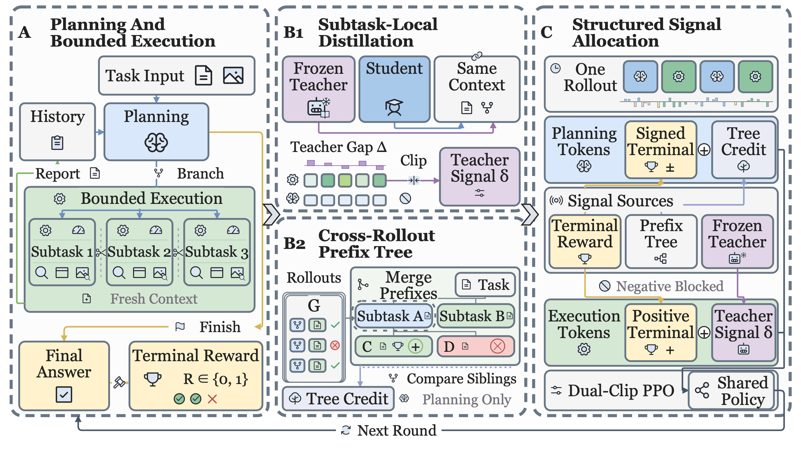

# SCAD: Structured Credit Assignment and Distillation for Long-Horizon Agents

[**Model**](https://huggingface.co/shangyangwu2002/SCAD) | [**Retrieval Corpus**](https://huggingface.co/datasets/shangyangwu2002/SCAD-Corpus)

## Overview

SCAD trains long-horizon agents by combining outcome-based credit assignment with local teacher supervision. A shared policy plans the task and executes bounded subtasks through three complementary designs:

- **Subtask-local distillation:** score student responses with a frozen teacher under the same local execution context.
- **Cross-rollout planning credit:** build subtask–report prefix trees from completed rollouts and compare returns under matched histories.
- **Structured signal allocation:** give planning signed terminal and tree credit, while execution receives positive terminal credit and local teacher guidance.

<p align="center">
  
</p>

## Performance

Text-only results with **Qwen3-4B** as the student and **Qwen3-4B-Instruct-2507** as the teacher. Accuracy is reported as mean ± sample standard deviation over three seeds. **Avg.** is the equal-weight average over **7 ID and 4 OOD datasets (814 questions)**.

SCAD achieves **46.10%** average accuracy, improving over the strongest training baseline (ATOD) by **4.48 percentage points**.

| Method | Avg. accuracy (%) |
| --- | ---: |
| Teacher | 45.56 ± 0.6 |
| Vanilla | 17.64 ± 0.5 |
| GRPO | 36.34 ± 1.4 |
| FoldGRPO | 39.60 ± 0.9 |
| Tree-GRPO | 40.81 ± 0.3 |
| HiPER | 41.49 ± 0.5 |
| SFT | 38.79 ± 2.2 |
| OPD | 38.06 ± 1.0 |
| SDAR | 39.49 ± 2.2 |
| ATOD | 41.62 ± 1.0 |
| TCOD | 38.94 ± 0.7 |
| MemOPD | 41.23 ± 0.9 |
| **SCAD (Ours)** | **46.10 ± 1.2** |

<details>
<summary>Per-benchmark mean accuracy (%)</summary>

| Method | BrowseComp-Plus | WebWalkerQA | HotpotQA | 2Wiki | MuSiQue | NQ | TriviaQA | Bamboogle† | PopQA† | GAIA† | xbench† | Avg. |
| --- | ---: | ---: | ---: | ---: | ---: | ---: | ---: | ---: | ---: | ---: | ---: | ---: |
| Teacher | 23.61 | 36.67 | 60.51 | 52.31 | 11.28 | 68.72 | 85.13 | 56.92 | 56.92 | 25.42 | 23.67 | 45.56 |
| Vanilla | 0.00 | 2.92 | 31.28 | 21.54 | 11.79 | 28.21 | 46.67 | 24.10 | 21.03 | 2.82 | 3.67 | 17.64 |
| GRPO | 19.44 | 28.75 | 40.00 | 46.15 | 10.77 | 63.59 | 75.90 | 32.82 | 42.05 | 15.25 | 25.00 | 36.34 |
| FoldGRPO | 17.22 | 34.58 | 52.31 | 52.31 | 13.33 | 63.08 | 71.28 | 41.54 | 55.38 | 13.56 | 21.00 | 39.60 |
| Tree-GRPO | 18.33 | 35.83 | 50.77 | 51.28 | 18.46 | 61.03 | 78.46 | 38.46 | 52.31 | 18.64 | 25.33 | 40.81 |
| HiPER | 21.67 | 32.92 | 54.36 | 46.15 | 16.92 | 66.15 | 73.85 | 43.59 | 53.85 | 18.64 | 28.33 | 41.49 |
| SFT | 19.17 | 33.33 | 47.69 | 48.21 | 11.79 | 63.08 | 71.28 | 40.00 | 52.31 | 17.51 | 22.33 | 38.79 |
| OPD | 19.72 | 28.75 | 51.79 | 45.64 | 13.85 | 65.64 | 71.79 | 37.44 | 47.18 | 11.86 | 25.00 | 38.06 |
| SDAR | 15.83 | 35.00 | 44.10 | 54.87 | 8.72 | 58.46 | 82.56 | 35.90 | 56.41 | 15.82 | 26.67 | 39.49 |
| ATOD | 21.39 | 33.75 | 53.85 | 50.77 | 13.85 | 64.10 | 75.90 | 45.13 | 56.92 | 17.51 | 24.67 | 41.62 |
| TCOD | 20.83 | 30.83 | 47.69 | 49.23 | 11.79 | 59.49 | 80.00 | 41.54 | 50.77 | 14.12 | 22.00 | 38.94 |
| MemOPD | 21.67 | 36.25 | 50.26 | 46.67 | 14.87 | 62.56 | 76.92 | 44.10 | 56.92 | 22.60 | 20.67 | 41.23 |
| **SCAD (Ours)** | **23.06** | **40.42** | **55.38** | **56.41** | **18.97** | **71.28** | **84.10** | **45.64** | **58.97** | **23.16** | **29.67** | **46.10** |

† denotes OOD datasets absent from training. Bold highlights SCAD.

</details>

## Installation

Use **Linux, Python 3.11, and CUDA 12.8**. Run all commands from the repository root.

```bash
python3.11 -m venv .venv
source .venv/bin/activate
python -m pip install -r requirements.txt
python -m pip install flash-attn==2.8.3 --no-build-isolation
python -m pip install --no-deps -e .
cp .env.example .env
```

Set `JUDGE_API_KEY`, `JUDGE_API_BASE`, and `JUDGE_MODEL` in `.env` for final-answer grading, and `SERPAPI_API_KEYS` for live search.

## Models

[SCAD model weights](https://huggingface.co/shangyangwu2002/SCAD) are available on Hugging Face.

```bash
# Download SCAD weights and the retrieval embedding model
python -m scripts.download_models --task released
```

The checkpoint is saved to `models/shangyangwu2002/SCAD/`; the embedding model is saved to `models/Qwen/Qwen3-Embedding-4B/`.

For training, download the reference students and teachers for the modality you need:

```bash
python -m scripts.download_models --task text
python -m scripts.download_models --task multimodal
```

Use `--task all` to download all reference models and the released checkpoint. Set `--output-root` to change the model directory, and set the matching `MODELS_ROOT` in `.env` for the launchers.

## Data Preparation

Download the [SCAD retrieval corpus](https://huggingface.co/datasets/shangyangwu2002/SCAD-Corpus), then reconstruct benchmark tables from official sources. For [GAIA](https://huggingface.co/datasets/gaia-benchmark/GAIA) and [OVEN](https://huggingface.co/datasets/ychenNLP/oven), obtain access and run `hf auth login` first.

```bash
hf download shangyangwu2002/SCAD-Corpus --repo-type dataset \
  --revision 71bdf10ac548d482951f5a854f8d0ed15c9e3ef5 \
  --local-dir ../SCAD_DATA
(cd ../SCAD_DATA && sha256sum -c SHA256SUMS --quiet)
bash scripts/download_data.sh all
```

Each modality uses **train, val, and test**. ID and OOD benchmarks are evaluated together in a single test run:

| Modality | Train | Validation | Test ID | Test OOD | Test total | Test datasets (ID + OOD) |
| --- | ---: | ---: | ---: | ---: | ---: | ---: |
| Text | 400 | 130 | 525 | 289 | 814 | 7 + 4 |
| Multimodal | 347 | 85 | 395 | 115 | 510 | 5 + 3 |

Text OOD datasets are **Bamboogle, PopQA, GAIA, and xbench**; multimodal OOD datasets are **FVQA, InfoSeek, and LiveVQA**.

Benchmark questions, answers, and query images are obtained from their official sources. The corpus supplies retrieval evidence; dense embeddings and indexes are generated locally. All test benchmarks are evaluated together, with each example retaining its original retrieval mode.

Build embeddings and retrieval indexes for the modality you need:

```bash
CUDA_VISIBLE_DEVICES=0 EMBED_N_GPUS=1 bash scripts/prepare_data.sh text
CUDA_VISIBLE_DEVICES=0 EMBED_N_GPUS=1 bash scripts/prepare_data.sh multimodal
```

Embeddings use **Qwen3-Embedding-4B** and need about **133 GiB per modality**, plus space for models and indexes. Prepared files are saved under `runtime/`.

For live multimodal image search, host `SCAD_DATA/multimodal/dataset/public_images/` at publicly accessible HTTP(S) URLs and set `MM_PUBLIC_IMAGE_BASE_URL` **before** preparing the multimodal runtime tables. Frozen training and validation use the packaged image-search cache. Configuration options are in [.env.example](.env.example).

## Evaluation

Keep the matching search service running in another terminal:

```bash
bash scripts/start_search.sh text
```

Evaluate SCAD:

```bash
bash scripts/evaluate.sh 4b --model models/shangyangwu2002/SCAD
```

To evaluate a training run, the launcher selects the checkpoint with the best validation macro accuracy:

```bash
bash scripts/evaluate.sh 4b
bash scripts/evaluate.sh 1_7b
# Keep `bash scripts/start_search.sh multimodal` running for this profile.
bash scripts/evaluate.sh 2b
```

Results include per-dataset accuracy, equal-dataset **macro accuracy**, and question-weighted **micro accuracy** in `test_results.json`, `test_results.csv`, and `test_results.md` under the evaluation output directory. Macro accuracy corresponds to the overall average reported above.

Set `OUTPUT_DIR` to locate a training run, `BEST_CHECKPOINT` to select a local training checkpoint, or `EVAL_OUTPUT_DIR` to choose a results directory. For local training checkpoints, use the same GPU count as training.

## Training

Keep the matching search service running during training.

| Student | Search | Training | Training GPUs |
| --- | --- | --- | ---: |
| Qwen3-4B | `bash scripts/start_search.sh text` | `bash scripts/train_4b.sh` | 4 |
| Qwen3-1.7B | `bash scripts/start_search.sh text` | `bash scripts/train_1_7b.sh` | 2 |
| Qwen3-VL-2B-Instruct | `bash scripts/start_search.sh multimodal` | `bash scripts/train_2b.sh` | 2 |

Reference training uses **RTX PRO 6000 GPUs (96 GB each)**. Evaluation defaults to the same GPU counts for each profile. Search uses GPU 0 by default; set `SEARCH_CUDA_VISIBLE_DEVICES` to select another GPU. Checkpoints and logs are saved under `outputs/`.

Set `SEED` and `OUTPUT_DIR` to run additional seeds.

## Project Structure

```text
SCAD/
├── agents/          # Planner–Worker rollouts and prompts
├── assets/          # Method figure
├── configs/         # Agent loops and fixed benchmark selections
├── envs/            # Text/multimodal retrieval and grading
├── samplers/        # Stratified source sampling
├── scripts/         # Data, models, training, and evaluation
└── verl/            # Modified training framework and SCAD advantages
```

The SCAD advantage computation is in `verl/trainer/ppo/scad.py`, prefix-tree construction is in `verl/trainer/ppo/scad_nodes.py`, and Planner–Worker rollouts are in `agents/scad_agent.py`.

## Acknowledgements and License

We thank the developers of [verl](https://github.com/volcengine/verl), [Qwen](https://github.com/QwenLM), and the benchmark and retrieval resources used in this work. Code is released under [Apache-2.0](LICENSE); third-party notices are in [THIRD_PARTY_NOTICES.md](THIRD_PARTY_NOTICES.md). Datasets and models retain their upstream licenses.
